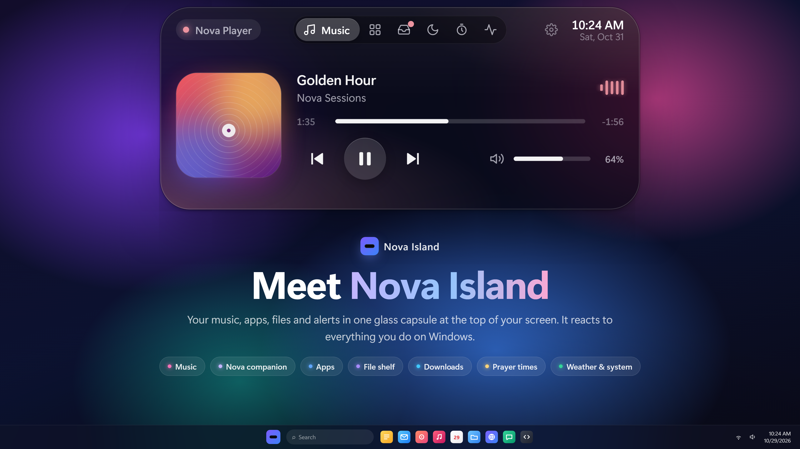
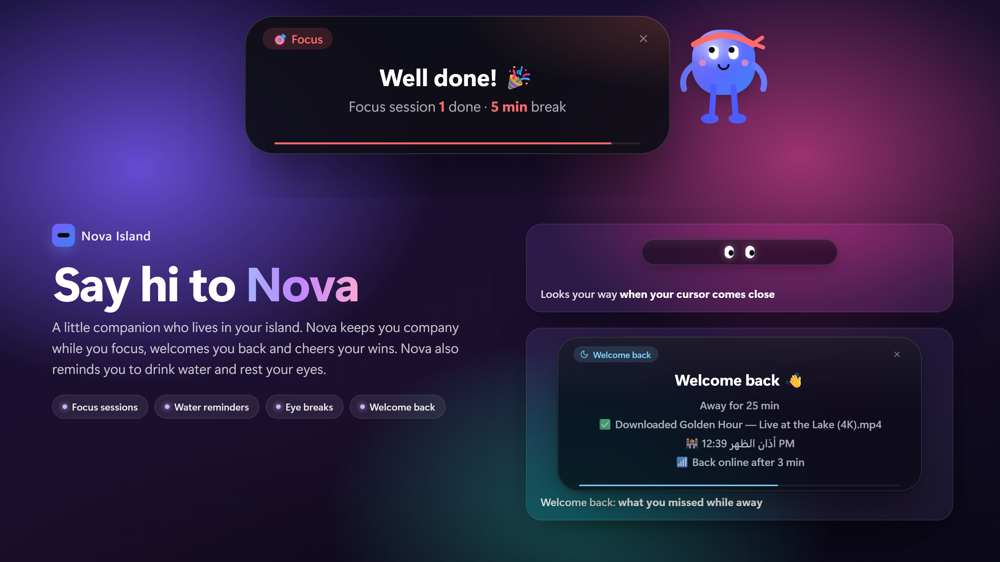
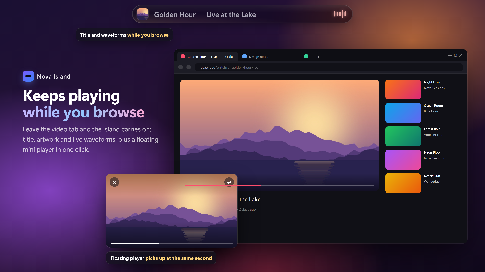
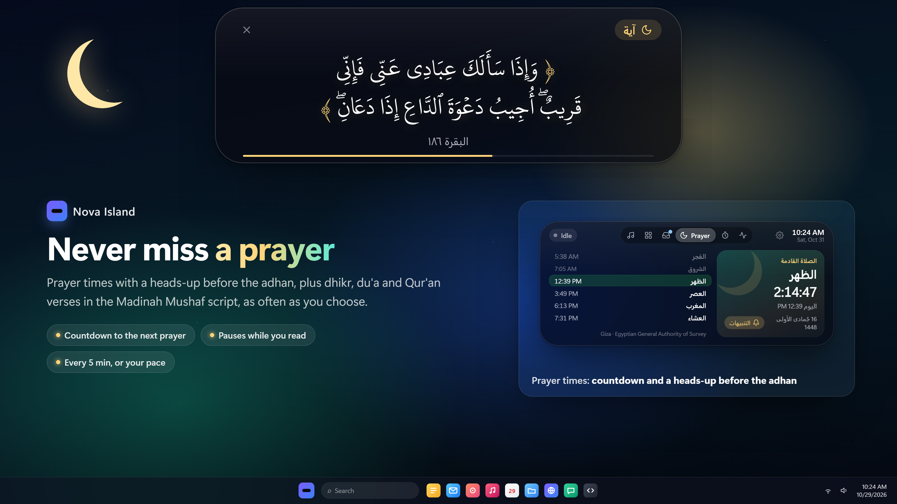
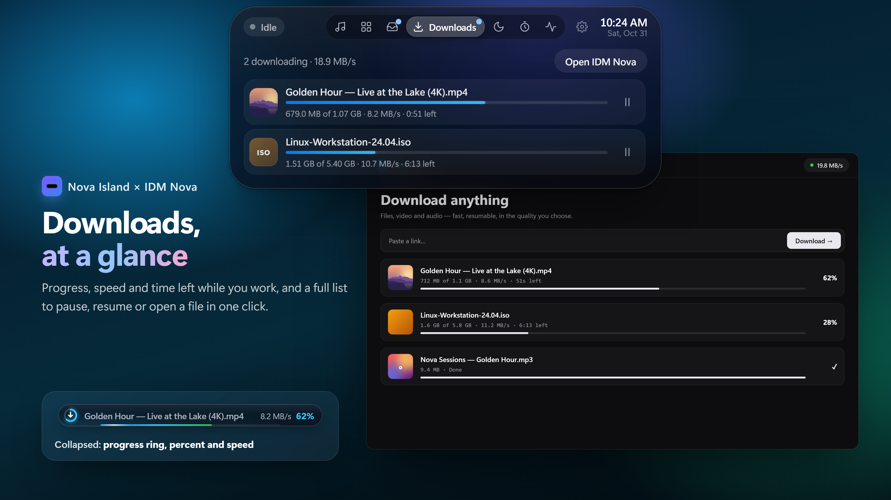
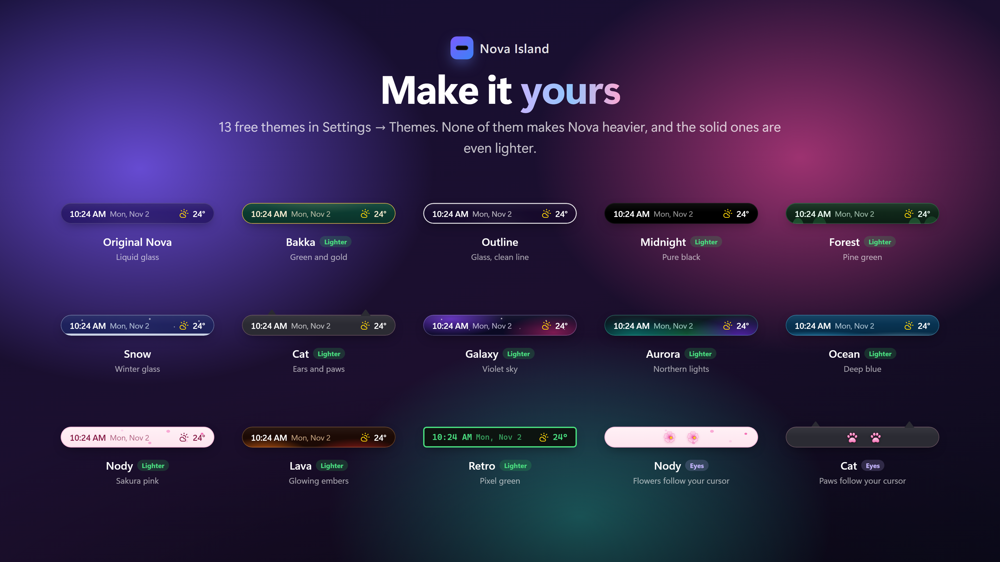
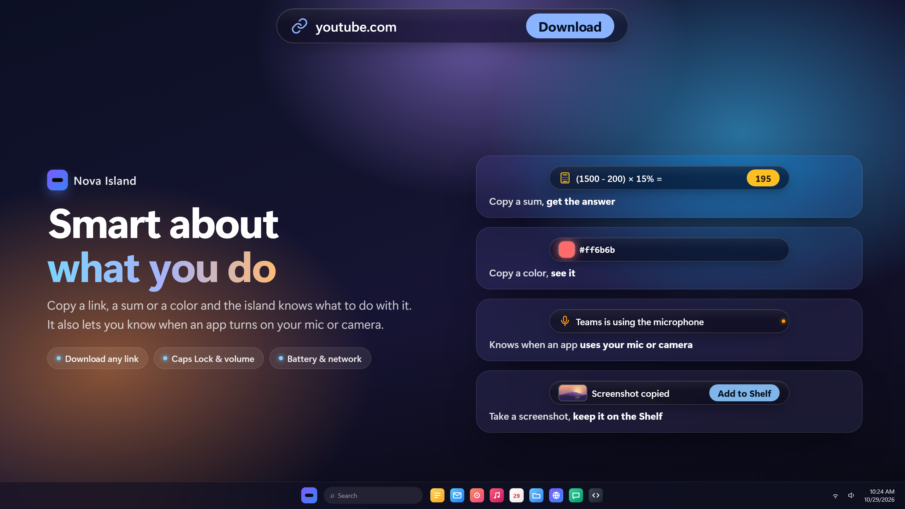
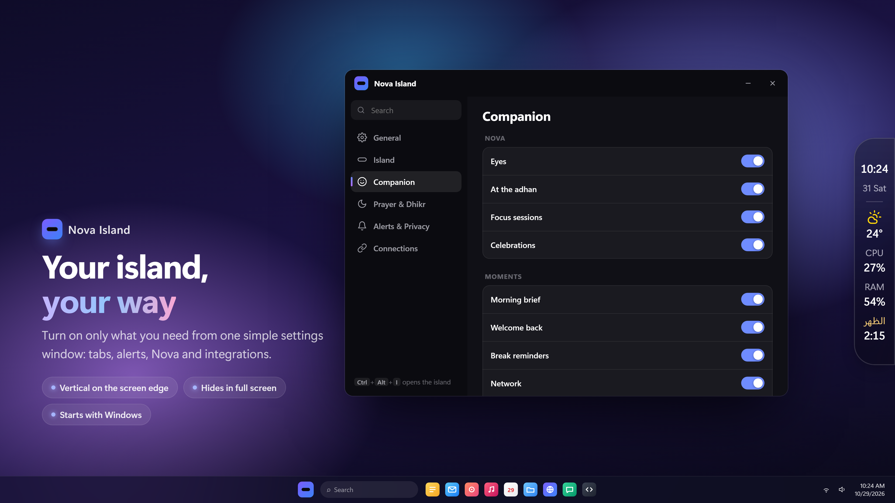

<div align="center">

# Nova Island

**A living island for your Windows desktop.**

Your music, apps, files and alerts in one glass capsule at the top of your screen — with Nova, a little companion who keeps you company.

[**Download for Windows**](https://nova-tech-kit.github.io/nova-island/) · [Microsoft Store](https://apps.microsoft.com/detail/9PHV3N1V2H7M) · Free and open source (GPL v3)

[](../../releases/latest)
[](../../stargazers)
[](https://ko-fi.com/binamer)
[](https://t.me/nova4apps)



</div>

## Features

### Say hi to Nova
A little companion who lives in your island. Nova keeps you company while you focus, welcomes you back, cheers your wins, and reminds you to drink water and rest your eyes.



### Keeps playing while you browse
Title, artwork and live waveforms of whatever is playing, plus a floating mini player in one click.



### Never miss a prayer
Prayer times with a heads-up before the adhan, plus dhikr, du'a and Qur'an verses in the KFGQPC Hafs script, as often as you choose.



### Downloads, at a glance
Progress, speed and time left while you work, with IDM Nova — pause, resume or open a file in one click.



### Make it yours
13 free themes in Settings → Themes, from liquid glass to pure black, sakura pink and pixel green. None of them makes Nova heavier, and the solid ones are even lighter.



### Smart about what you do
Copy a link, a sum or a color and the island knows what to do with it. It also lets you know when an app turns on your mic or camera.



### Your island, your way
Turn on only what you need from one simple settings window. Vertical on the screen edge, hides in full screen, starts with Windows.



## Install

1. Download **Nova Island** from [the website](https://nova-tech-kit.github.io/nova-island/), or get it from the [Microsoft Store](https://apps.microsoft.com/detail/9PHV3N1V2H7M).
2. Run it. With the direct download, Windows may show "Windows protected your PC" because the app is not code-signed yet — choose **More info → Run anyway**. The Store version doesn't show it.
3. The island appears at the top of your screen. Press **Ctrl + Alt + I** to open it.

Requires Windows 10 or 11 (64-bit).

## Build from source

```bash
npm install
npm start          # run it
npm run dist       # build the installer into dist/
```

## Support Nova Island ☕

Nova Island is free, with no ads and no tracking, and it always will be. If it makes your day a little better, you can buy us a coffee:

- **Ko-fi** (cards, PayPal): [ko-fi.com/binamer](https://ko-fi.com/binamer)
- **InstaPay** (Egypt): [Send via InstaPay](https://ipn.eg/S/binamerbm/instapay/38txJO)

Stars ⭐ and sharing it with a friend help a lot too.

## License

Nova Island is free software, licensed under the [GNU General Public License v3.0](LICENSE).

Copyright © 2026 Nova Island by AmerTech.

The Qur'an font in `fonts/` (KFGQPC HAFS Uthmanic Script by the King Fahd Glorious Quran Printing Complex) is included unmodified under its own license — see [fonts/KFGQPC-LICENSE.txt](fonts/KFGQPC-LICENSE.txt). It is not covered by the GPL.

The name "Nova Island" and its logo are not covered by the GPL; please use a different name for modified versions.
